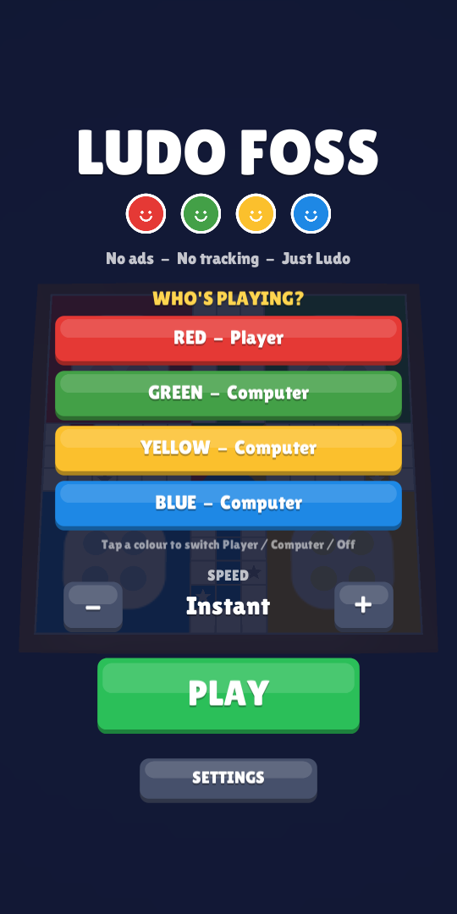
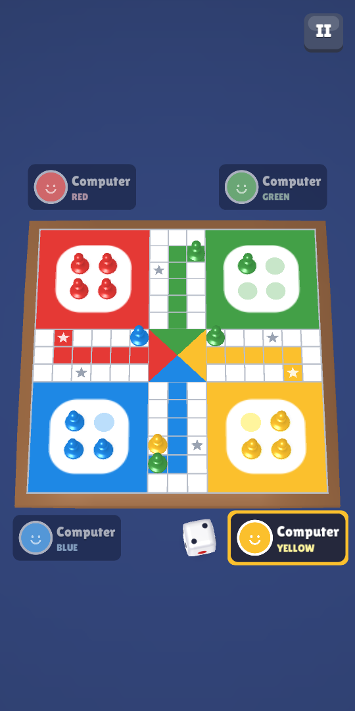
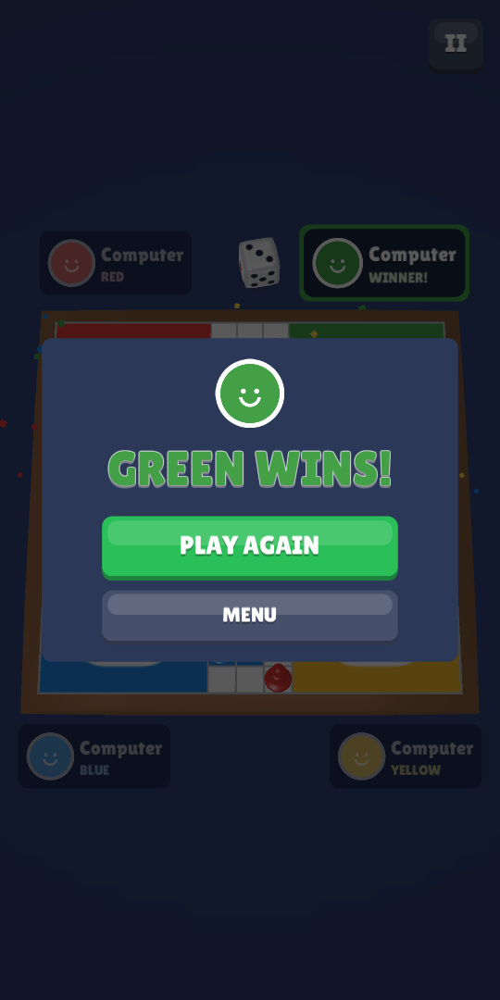

# Ludo FOSS

A free, open-source Ludo game for Android. 3D board, smooth animations, your own speed, and nothing else: no ads, no accounts, no tracking, no internet.

<p>
  
  
  
</p>

## Features

- **3D board and pieces**: glossy pawns that hop square to square, a die that really tumbles, confetti when a pawn gets home, a knock-back with a little screen shake on captures
- **Speed control** from 1x (classic pace) up to **Instant**, adjustable mid-game
- **Play vs computer**: any colour can be a bot
- **Pass & play**: 2 to 4 people on one phone; your colour is turned to the bottom-left
- **Auto-move**: when only one move is possible, it happens by itself
- **Sound and vibration**, each switchable
- Classic rules: a 6 to leave base, an extra turn on a 6, a capture or reaching home, safe star squares, an exact roll to finish, and an optional rule where three 6s in a row lose the turn

## Privacy and battery

- The APK requests **no permissions except vibration**. Without the internet permission, Android won't let it go online at all.
- No ad, analytics or tracking libraries.
- **Battery friendly**: the game only draws at full speed while something moves. While it waits for your tap it drops to 10-20 frames per second. The 3D is deliberately simple (two small custom shaders, one fixed light, painted shadows), and **Battery saver** in Settings caps animations at 30 fps.

## Project layout

```
Assets/
  Scripts/Core/         Pure C# game rules (no Unity dependency): board, moves, captures, bot
  Scripts/Game/         Match flow, menus, settings, sound, vibration
  Scripts/Game/Render/  3D board, pawns, die, camera, particles, frame-rate governor
  Scripts/Dev/          Screenshot helper for desktop preview builds (inactive in normal play)
  Editor/               Android build, Windows preview build, rules self-test
  Resources/            Shaders, sounds and font
  Scenes/Main.unity     Empty scene; everything is built from code at startup
```

Meshes and textures (board, pawns, die, icons) are generated in code, so there are no model or image files to manage.

## Build the APK

Requires Unity **6000.3.25f1** with Android Build Support.

From the Unity editor: **Ludo > Build Android APK**. Or from a terminal:

```
Unity.exe -batchmode -quit -projectPath . -buildTarget Android -executeMethod LudoGame.EditorTools.BuildAndroid.Build -logFile build.log
```

The APK is written to `Builds/LudoFOSS.apk`.

## Test the rules

**Ludo > Run Self Test**, or:

```
Unity.exe -batchmode -quit -projectPath . -executeMethod LudoGame.EditorTools.SelfTest.Run -logFile test.log
```

This checks the board geometry and rules, then plays 400 computer-only games.

## Preview on Windows (no phone needed)

**Ludo > Build Windows Preview** (or `-buildTarget Win64 -executeMethod LudoGame.EditorTools.WindowsPreview.Build`), then:

```
Builds\Windows\LudoFOSS.exe -screen-width 540 -screen-height 1170
```

Add `-demo-capture <folder>` to have it play a computer-only match, save four screenshots and quit.

## Install on your phone

Copy `Builds/LudoFOSS.apk` to the phone, open it, and allow "Install unknown apps" for your file manager when Android asks.

## Adding mods

- Speed and timing: `GameSettings.Scale` and the durations in `Match.cs`
- Animations: `Render/Pawn3D.cs` (hops, captures) and `Render/Dice3D.cs` (the roll)
- Rules: `Core/Rules.cs` (legal moves, captures, extra turns)
- Bot behaviour: `Core/Bot.cs` (move scoring)
- Settings screen: `GameRoot.OpenSettings`

## Credits

- Sound effects: [Kenney](https://kenney.nl) (Casino Audio, Interface Sounds, Impact Sounds, Music Jingles), CC0 public domain
- Font: [Lilita One](https://fonts.google.com/specimen/Lilita+One) by Juan Montoreano, SIL Open Font License 1.1

## License

GPL-3.0. See [LICENSE](LICENSE). You may use, study, change and share this game; if you share a modified version, it must stay open source under the same license.
